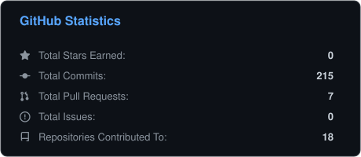
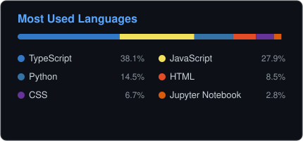

# Mohammed Nasir

### AI & Full-Stack Developer | Machine Learning | Generative AI, RAG & AI Agents | Open Source Contributor | Exploring Cloud Computing, DevOps & Emerging Technologies

  

## About

I'm a Computer Science student passionate about software development, artificial intelligence, and building technology that solves real-world problems.

I enjoy working across the development stack, exploring how applications are designed, developed, and deployed. Beyond building projects, I'm actively strengthening my computer science fundamentals, contributing to open-source projects, and learning from developer communities.

Currently exploring the intersection of full-stack development, AI engineering, and open-source software while preparing for Google Summer of Code 2027.

## What I'm Focused On

- 🌐 Building modern web applications using JavaScript, React, Next.js, and Node.js.
- 🤖 Exploring Machine Learning, Generative AI, Retrieval-Augmented Generation (RAG), and AI Agents.
- 💻 Strengthening my programming fundamentals through C, C++, Java, and Data Structures & Algorithms.
- 🌱 Contributing to open-source projects, understanding large codebases, and collaborating with developers.
- ☁️ Exploring cloud computing, DevOps, and emerging technologies.

---

## 📊 GitHub Stats

  
  

---

## 📈 GitHub Contributions

  

---

## 🛠️ Tech Stack

### Programming Languages

  

### Web Development

  

### Backend & Databases

  
  

### Tools & Platforms

  
  

  
  

---

## Contact

  
  
  
  

